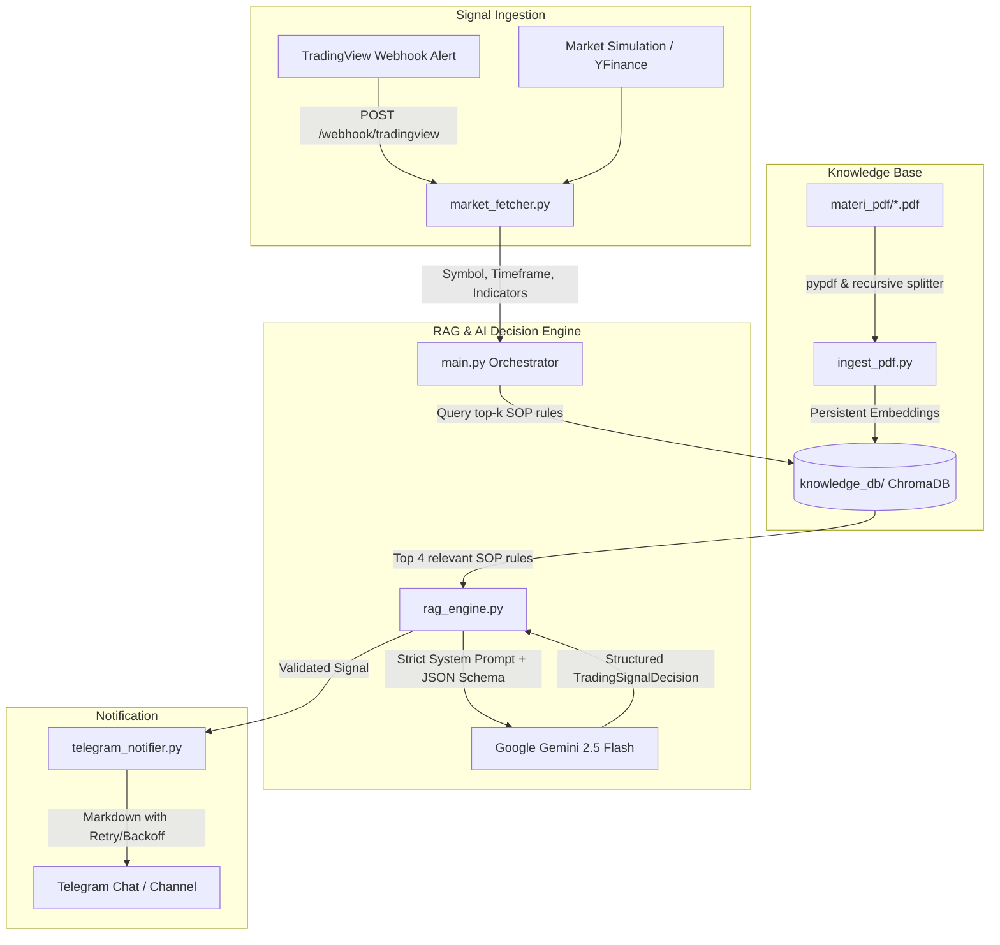

# AI Trading Signal Bot (RAG + Telegram Dispatcher)

A modular, production-ready AI Trading Signal Bot in Python with a Retrieval-Augmented Generation (RAG) architecture. It indexes proprietary trading books and SOP documents (PDFs) into a local ChromaDB vector database, evaluates incoming Forex and Stock market setups strictly against indexed trading rules using Google Gemini 2.5 Flash, and dispatches structured, fast-response trading alerts directly to a designated Telegram chat.

---

## 🏛️ System Architecture



---

## 📁 Project Directory Structure

```text
trading-ai-bot/
├── materi_pdf/                  # Directory containing trading book PDFs
├── knowledge_db/                # Local ChromaDB persistent vector database
├── config.py                    # Pydantic Settings and centralized logging
├── ingest_pdf.py                # PDF extraction, recursive chunking, and ChromaDB indexing
├── rag_engine.py                # RAG retrieval and strict AI prompt builder (Gemini 2.5 Flash)
├── market_fetcher.py            # TradingView webhook receiver, YFinance connector, simulator
├── telegram_notifier.py         # Async Telegram notification dispatcher with retry
├── main.py                      # Main entrypoint and pipeline orchestrator
├── requirements.txt             # Project dependencies
├── .env.example                 # Configuration template
└── README.md                    # Setup and operational documentation
```

---

## 🚀 Quickstart Guide

### 1. Prerequisites
- Python 3.10+ (tested on Python 3.12)
- Google Gemini API Key ([Google AI Studio](https://aistudio.google.com/))
- Telegram Bot Token & Chat ID (from [@BotFather](https://t.me/BotFather))

### 2. Installation

Clone or open the project directory and create a virtual environment:

```bash
python3 -m venv .venv
source .venv/bin/activate
pip install -r requirements.txt
```

### 3. Configure Environment Variables

Copy `.env.example` to `.env` and fill in your keys:

```bash
cp .env.example .env
```

Edit `.env`:
```env
# Google Gemini API
GEMINI_API_KEY=your_gemini_api_key_here
GEMINI_MODEL=gemini-2.5-flash

# Telegram Bot
TELEGRAM_BOT_TOKEN=123456789:ABCdefGhIJKlmNoPQRsTUVwxyZ
TELEGRAM_CHAT_ID=-1001234567890

# Webhook Server
WEBHOOK_HOST=0.0.0.0
WEBHOOK_PORT=8000
DATA_SOURCE=webhook

# Paths
PDF_DIR=./materi_pdf
KNOWLEDGE_DIR=./knowledge_db
COLLECTION_NAME=trading_rules
TOP_K_RULES=4
```

---

## 📖 Usage Instructions

### 1. Ingest PDF Trading Materials into ChromaDB

Place your trading strategy books or SOP documents (`.pdf`) inside `./materi_pdf/`. Then run:

```bash
python ingest_pdf.py
```

*To force re-indexing from scratch:*
```bash
python ingest_pdf.py --force
```

- Chunks text into ~1000 character segments with 150-character overlap.
- Uses SHA-256 chunk IDs for incremental indexing (avoids duplicate records).
- Preserves filename, page number, and chunk position metadata.

### 2. Run in Simulation Mode (Testing)

You can run an end-to-end dry run without connecting live brokers or TradingView:

```bash
# Test EURUSD simulation scenario
python main.py --simulate EURUSD

# Test XAUUSD (Gold) simulation scenario
python main.py --simulate XAUUSD

# Test Stock (BBCA.JK) simulation scenario
python main.py --simulate BBCA.JK
```

### 3. Launch the Production Webhook Server

Start the FastAPI ASGI server to listen for incoming TradingView webhooks:

```bash
python main.py --port 8001
```

---

## 📡 TradingView Webhook Integration

In TradingView Alert settings:
1. Check **Webhook URL**: `http://YOUR_SERVER_IP:8001/webhook/tradingview`
2. Set the Alert Message to JSON format:

```json
{
  "symbol": "EURUSD",
  "timeframe": "1h",
  "price": 1.0850,
  "indicator_status": "Bullish Engulfing pattern formed at key support (1.0820), MACD bullish crossover, RSI 38 rising",
  "strategy": "SOP Reversal Strategy",
  "notes": "Testing lower boundary of horizontal channel with long lower shadow rejection."
}
```

### Testing the Webhook with `curl`:

```bash
curl -X POST http://localhost:8001/webhook/tradingview \
  -H "Content-Type: application/json" \
  -d '{
    "symbol": "EURUSD",
    "timeframe": "1h",
    "price": 1.0850,
    "indicator_status": "Bullish Engulfing at key support, MACD golden cross",
    "notes": "Testing lower channel boundary"
  }'
```

---

## 🛡️ Strict SOP & Zero-Hallucination Policy

The RAG engine enforces uncompromising discipline:
- **Chief Technical Analyst Persona:** Evaluates the trade strictly as a risk manager.
- **Exclusive SOP Grounding:** Only setups that strictly fulfill the retrieved book/SOP rules are granted `BUY` or `SELL`.
- **Zero Hallucination:** If conditions are ambiguous, indicators conflict, or SOP rules do not explicitly confirm entry, the AI outputs `TINDAKAN: WAIT`.
- **Source Citation:** Every alert cites the source document and page number for auditability.

---

## 📱 Format Pesan Telegram (Bahasa Indonesia)

Pesan sinyal yang dikirimkan ke Telegram kini 100% menggunakan Bahasa Indonesia dengan tata letak Markdown yang rapi:

```text
⚡ SINYAL TRADING AI ⚡
══════════════════════════════
📊 Instrumen: EURUSD | ⏱️ Timeframe: 1h
🎯 🟢 TINDAKAN: BUY (BELI KUAT)
──────────────────────────────
📍 Zona Entry: 1.0845 - 1.0855
🛑 Stop Loss (SL): 1.0810
🎯 Take Profit (TP): 1.0920
⚖️ Rasio Risk/Reward: 1:2.1
📈 Tingkat Keyakinan: 85%
──────────────────────────────
📖 Sumber SOP: Steve-Nison-Japanese-Candlestick-Charting-Techniques.pdf hal. 45

📝 Analisis Teknikal:
Pola Bullish Engulfing memenuhi kriteria reversal SOP pada area support horizontal utama. Histogram MACD bergerak positif mengonfirmasi momentum bullish.
══════════════════════════════
⚠️ Peringatan Risiko: Analisis AI berdasarkan buku SOP. Tetap lakukan riset mandiri (DYOR).
```
